# ผลการทำซ้ำ: Multimodal Swarm Learning สำหรับตรวจจับ DDoS บน IoT (Fabric)

สร้างโดย `report.py` จากไฟล์ใน `results/runs/` ตัวเลขเปเปอร์มาจาก Tables 13–16 ของ Nguyen-Khanh et al., *EAI Endorsed Trans. Ind. Netw. Intell. Syst.* 13(1), 2026 (doi:10.4108/eetinis.131.9961)

## Scenario 1

hosts (train/val/test): http-icmp (187,362/20,818/23,132), tcp-syn (81,690/9,077/10,085), udp (196,617/21,846/24,273) · packet features 71

SL รอบ aggregation: 17

| สถาปัตยกรรม | โมเดล | merge | Accuracy | Precision | Recall | F1 | test loss | เปเปอร์ (Acc / P / R / F1) |
|---|---|---|---|---|---|---|---|---|
| CL | packet | — | 100.00 | 100.00 | 100.00 | 100.00 | 0.0058 | 100.00 / 100.00 / 100.00 / 100.00 |
| CL | flow | — | 99.97 | 99.95 | 99.99 | 99.97 | 0.0010 | 96.85 / 94.28 / 99.88 / 97.00 |
| CL | multimodal | — | 100.00 | 100.00 | 100.00 | 100.00 | 0.0030 | 100.00 / 100.00 / 100.00 / 100.00 |
| SL | packet | mean | 100.00 | 100.00 | 100.00 | 100.00 | 0.0037 | 100.00 / 100.00 / 100.00 / 100.00 |
| SL | packet | coordmedian | 100.00 | 100.00 | 100.00 | 100.00 | 0.0044 | 100.00 / 99.99 / 100.00 / 99.99 |
| SL | packet | geomedian | 100.00 | 100.00 | 100.00 | 100.00 | 0.0035 | 100.00 / 100.00 / 100.00 / 100.00 |
| SL | flow | mean | 94.30 | 99.94 | 88.68 | 93.98 | 0.1637 | 96.59 / 93.96 / 99.70 / 96.75 |
| SL | flow | coordmedian | 92.60 | 99.95 | 85.28 | 92.03 | 1.2703 | 96.27 / 93.94 / 99.06 / 96.43 |
| SL | flow | geomedian | 92.48 | 99.98 | 85.01 | 91.88 | 1.1491 | 96.27 / 93.94 / 99.06 / 96.43 |
| SL | multimodal | mean | 99.93 | 100.00 | 99.85 | 99.93 | 0.0040 | 99.96 / 100.00 / 99.92 / 99.96 |
| SL | multimodal | coordmedian | 99.83 | 100.00 | 99.66 | 99.83 | 0.0122 | 99.52 / 99.32 / 99.75 / 99.53 |
| SL | multimodal | geomedian | 100.00 | 100.00 | 100.00 | 100.00 | 0.0014 | 99.50 / 99.26 / 99.75 / 99.50 |

test loss ของ SL multimodal เทียบ Table 16: mean 0.0040 (เปเปอร์ 0.0039) · coordmedian 0.0122 (เปเปอร์ 0.0181) · geomedian 0.0014 (เปเปอร์ 0.0177)

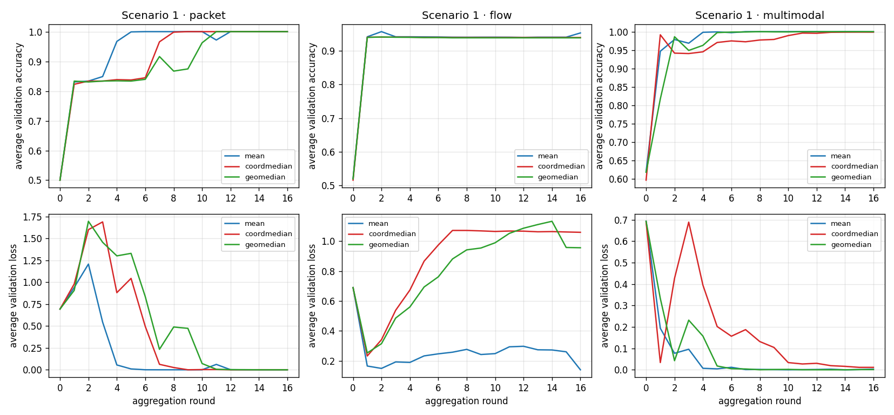

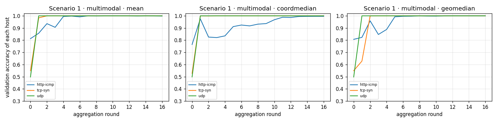

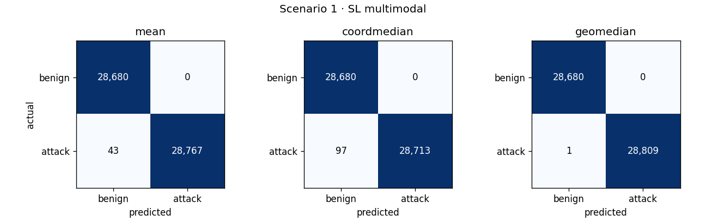

อัตราตรวจถูกต่อชนิดทราฟฟิก (multimodal, %):

| ชนิดทราฟฟิก | CL | mean | coordmedian | geomedian |
|---|---|---|---|---|
| Benign | 100.00 | 100.00 | 100.00 | 100.00 |
| DDoS_HTTP | 99.98 | 99.11 | 98.00 | 99.98 |
| DDoS_ICMP | 100.00 | 100.00 | 100.00 | 100.00 |
| DDoS_TCP | 100.00 | 100.00 | 100.00 | 100.00 |
| DDoS_UDP | 100.00 | 100.00 | 100.00 | 100.00 |

## Scenario 2

hosts (train/val/test): http-icmp (187,362/20,818/23,132), tcp-syn+udp (278,307/30,923/34,358), mqtt-publish+mqtt-connect (329,197/36,577/40,643) · packet features 125

SL รอบ aggregation: 27 (เปเปอร์ 27)

| สถาปัตยกรรม | โมเดล | merge | Accuracy | Precision | Recall | F1 | test loss | เปเปอร์ (Acc / P / R / F1) |
|---|---|---|---|---|---|---|---|---|
| CL | packet | — | 97.79 | 96.55 | 99.20 | 97.86 | 0.0591 | 100.00 / 100.00 / 100.00 / 100.00 |
| CL | flow | — | 99.70 | 99.71 | 99.71 | 99.71 | 0.0110 | 95.46 / 95.78 / 96.10 / 95.94 |
| CL | multimodal | — | 99.85 | 99.98 | 99.73 | 99.86 | 0.0066 | 100.00 / 100.00 / 100.00 / 100.00 |
| SL | packet | mean | 78.33 | 100.00 | 57.56 | 73.06 | 1.0654 | ไม่มีในเปเปอร์ |
| SL | packet | coordmedian | 78.29 | 100.00 | 57.49 | 73.01 | 4.3380 | ไม่มีในเปเปอร์ |
| SL | packet | geomedian | 78.29 | 100.00 | 57.49 | 73.01 | 2.1435 | ไม่มีในเปเปอร์ |
| SL | flow | mean | 75.40 | 87.75 | 60.23 | 71.43 | 0.6563 | ไม่มีในเปเปอร์ |
| SL | flow | coordmedian | 73.32 | 91.86 | 52.39 | 66.72 | 1.2003 | ไม่มีในเปเปอร์ |
| SL | flow | geomedian | 72.36 | 94.60 | 48.65 | 64.25 | 3.1526 | ไม่มีในเปเปอร์ |
| SL | multimodal | mean | 77.99 | 100.00 | 56.91 | 72.53 | 1.0058 | 98.62 / 98.81 / 98.71 / 98.76 |
| SL | multimodal | coordmedian | 78.32 | 100.00 | 57.54 | 73.05 | 2.3153 | 83.26 / 84.83 / 85.24 / 85.03 |
| SL | multimodal | geomedian | 78.29 | 100.00 | 57.49 | 73.01 | 3.9867 | 83.91 / 84.87 / 86.59 / 85.72 |

test loss ของ SL multimodal เทียบ Table 16: mean 1.0058 (เปเปอร์ 0.0352) · coordmedian 2.3153 (เปเปอร์ 0.7622) · geomedian 3.9867 (เปเปอร์ 0.7655)

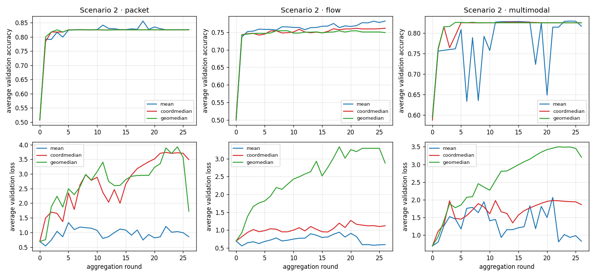

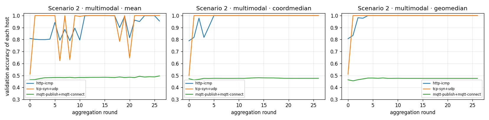

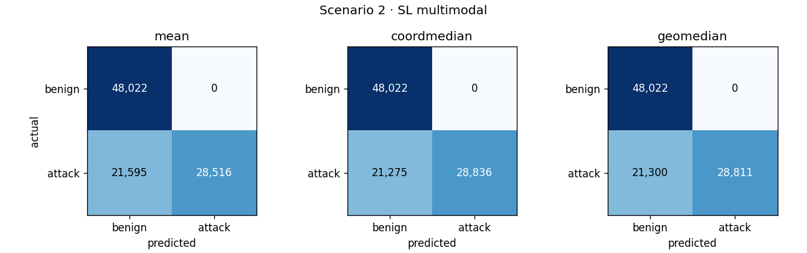

อัตราตรวจถูกต่อชนิดทราฟฟิก (multimodal, %):

| ชนิดทราฟฟิก | CL | mean | coordmedian | geomedian |
|---|---|---|---|---|
| Benign | 99.98 | 100.00 | 100.00 | 100.00 |
| DDoS_HTTP | 100.00 | 77.52 | 100.00 | 100.00 |
| DDoS_ICMP | 100.00 | 100.00 | 100.00 | 100.00 |
| DDoS_TCP | 100.00 | 100.00 | 100.00 | 100.00 |
| DDoS_UDP | 100.00 | 99.99 | 100.00 | 100.00 |
| MQTT-DDoS-Connect_Flood | 99.56 | 2.37 | 0.16 | 0.01 |
| MQTT-DDoS-Publish_Flood | 98.97 | 6.82 | 0.05 | 0.00 |

## Scenario 3

hosts (train/val/test): http-icmp (187,362/20,818/23,132), tcp-syn (81,690/9,077/10,085), udp (196,617/21,846/24,273), mqtt-publish (106,663/11,851/13,169), mqtt-connect (222,534/24,726/27,474) · packet features 125

SL รอบ aggregation: 18 (เปเปอร์ 18)

| สถาปัตยกรรม | โมเดล | merge | Accuracy | Precision | Recall | F1 | test loss | เปเปอร์ (Acc / P / R / F1) |
|---|---|---|---|---|---|---|---|---|
| CL | packet | — | 97.79 | 96.55 | 99.20 | 97.86 | 0.0591 | 100.00 / 100.00 / 100.00 / 100.00 |
| CL | flow | — | 99.70 | 99.71 | 99.71 | 99.71 | 0.0110 | 95.46 / 95.78 / 96.10 / 95.94 |
| CL | multimodal | — | 99.85 | 99.98 | 99.73 | 99.86 | 0.0066 | 100.00 / 100.00 / 100.00 / 100.00 |
| SL | packet | mean | 78.77 | 98.56 | 59.28 | 74.03 | 0.8319 | 97.17 / 99.82 / 95.09 / 97.40 |
| SL | packet | coordmedian | 78.29 | 100.00 | 57.49 | 73.01 | 2.3990 | 94.05 / 99.03 / 90.22 / 94.42 |
| SL | packet | geomedian | 78.29 | 100.00 | 57.49 | 73.01 | 2.9286 | 95.00 / 99.02 / 91.95 / 95.35 |
| SL | flow | mean | 73.17 | 92.37 | 51.72 | 66.31 | 0.7210 | 70.70 / 87.93 / 55.02 / 67.69 |
| SL | flow | coordmedian | 72.74 | 92.07 | 51.01 | 65.65 | 1.3675 | 73.65 / 81.87 / 67.76 / 74.15 |
| SL | flow | geomedian | 72.04 | 91.39 | 49.94 | 64.59 | 1.6745 | 75.01 / 82.38 / 70.22 / 75.82 |
| SL | multimodal | mean | 74.11 | 99.23 | 49.68 | 66.21 | 1.0000 | 92.62 / 99.78 / 86.95 / 92.93 |
| SL | multimodal | coordmedian | 74.59 | 93.99 | 53.66 | 68.32 | 0.9860 | 89.20 / 96.58 / 83.60 / 89.62 |
| SL | multimodal | geomedian | 78.51 | 99.99 | 57.93 | 73.36 | 2.4194 | 89.69 / 96.88 / 84.24 / 90.12 |

test loss ของ SL multimodal เทียบ Table 16: mean 1.0000 (เปเปอร์ 0.1968) · coordmedian 0.9860 (เปเปอร์ 0.5151) · geomedian 2.4194 (เปเปอร์ 0.476)

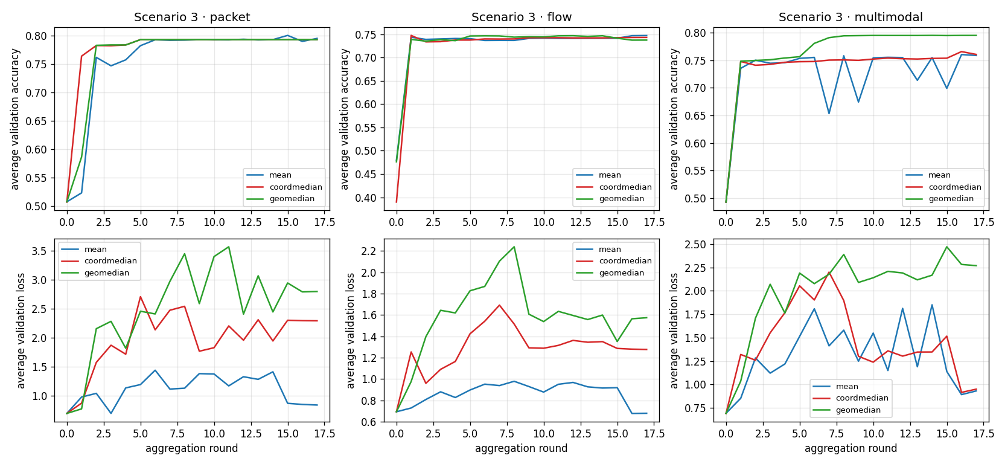

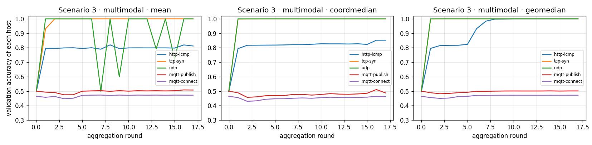

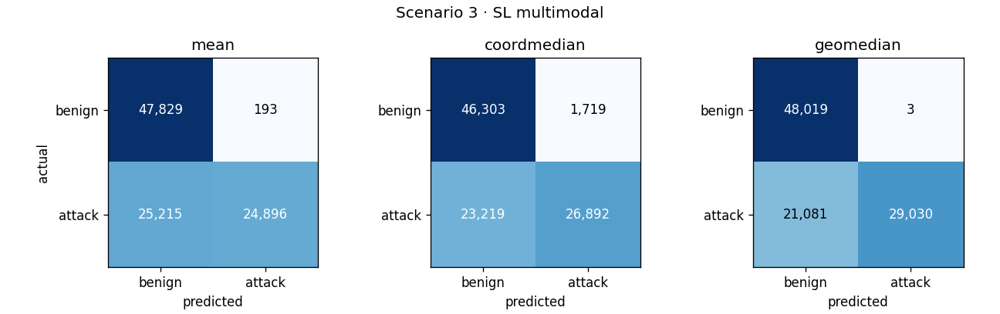

อัตราตรวจถูกต่อชนิดทราฟฟิก (multimodal, %):

| ชนิดทราฟฟิก | CL | mean | coordmedian | geomedian |
|---|---|---|---|---|
| Benign | 99.98 | 99.60 | 96.42 | 99.99 |
| DDoS_HTTP | 100.00 | 10.57 | 31.21 | 100.00 |
| DDoS_ICMP | 100.00 | 100.00 | 100.00 | 100.00 |
| DDoS_TCP | 100.00 | 100.00 | 100.00 | 100.00 |
| DDoS_UDP | 100.00 | 99.96 | 100.00 | 100.00 |
| MQTT-DDoS-Connect_Flood | 99.56 | 1.92 | 6.82 | 1.37 |
| MQTT-DDoS-Publish_Flood | 98.97 | 2.26 | 6.33 | 0.27 |

## หาสาเหตุ: น้ำหนักของ node และ node ที่จบก่อน

SL ชุดเดิมเทียบกับการเปลี่ยนค่า default ของ SwarmCallback สองตัว: **ถ่วงด้วยจำนวนข้อมูล** (nodeWeightage = จำนวนแถว train ที่ node ประกาศบน ledger) และ **inactive** (checkinModelOnTrainEnd: node ที่ครบ 10 epoch แล้วเลิกส่ง weights) เมื่อเหลือ node ที่ยังส่ง weights น้อยกว่า quorum (majority) chaincode ปิดรอบไม่ได้ จึงไม่มีการ merge ในรอบนั้น และโมเดลสุดท้ายคือโมเดลของ node ที่ฝึกนานที่สุด (คอลัมน์ 'รอบที่ merge')

### Scenario 2 · multimodal

อัตราตรวจถูกต่อชนิดทราฟฟิก (%):

| merge | variant | Accuracy | F1 | test loss | รอบที่ merge | Benign | DDoS_HTTP | DDoS_ICMP | DDoS_TCP | DDoS_UDP | MQTT Connect | MQTT Publish |
|---|---|---|---|---|---|---|---|---|---|---|---|---|
| mean | เปเปอร์ (equal, snapshot) | 77.99 | 72.53 | 1.0058 | 27/27 | 100.00 | 77.52 | 100.00 | 100.00 | 99.99 | 2.37 | 6.82 |
| mean | ถ่วงด้วยจำนวนข้อมูล | 78.73 | 73.69 | 1.0527 | 27/27 | 100.00 | 99.22 | 100.00 | 100.00 | 100.00 | 1.58 | 3.55 |
| mean | inactive | 45.38 | 48.28 | 2.9587 | 23/27 | 40.65 | 2.27 | 0.00 | 74.47 | 0.00 | 99.59 | 99.04 |
| mean | ถ่วง + inactive | 46.52 | 49.85 | 2.4026 | 23/27 | 40.75 | 6.08 | 0.01 | 92.09 | 0.00 | 99.58 | 99.07 |
| coordmedian | เปเปอร์ (equal, snapshot) | 78.32 | 73.05 | 2.3153 | 27/27 | 100.00 | 100.00 | 100.00 | 100.00 | 100.00 | 0.16 | 0.05 |
| coordmedian | ถ่วงด้วยจำนวนข้อมูล | 78.32 | 73.05 | 2.3153 | 27/27 | 100.00 | 100.00 | 100.00 | 100.00 | 100.00 | 0.16 | 0.05 |
| coordmedian | inactive | 45.50 | 48.59 | 3.3051 | 23/27 | 40.34 | 14.44 | 0.00 | 68.60 | 0.00 | 99.38 | 98.92 |
| coordmedian | ถ่วง + inactive | 43.69 | 45.77 | 3.1518 | 23/27 | 40.71 | 11.95 | 0.01 | 31.06 | 0.00 | 99.65 | 99.07 |
| geomedian | เปเปอร์ (equal, snapshot) | 78.29 | 73.01 | 3.9867 | 27/27 | 100.00 | 100.00 | 100.00 | 100.00 | 100.00 | 0.01 | 0.00 |
| geomedian | ถ่วงด้วยจำนวนข้อมูล | 78.32 | 73.06 | 4.2928 | 27/27 | 100.00 | 100.00 | 100.00 | 100.00 | 100.00 | 0.18 | 0.05 |
| geomedian | inactive | 54.60 | 60.52 | 2.7137 | 23/27 | 40.45 | 29.46 | 96.91 | 100.00 | 0.00 | 99.30 | 98.97 |
| geomedian | ถ่วง + inactive | 54.41 | 60.21 | 1.7692 | 23/27 | 40.70 | 20.40 | 99.99 | 97.42 | 0.00 | 99.63 | 99.12 |

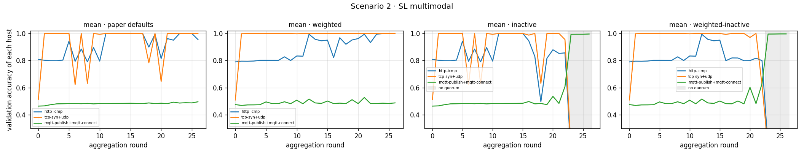

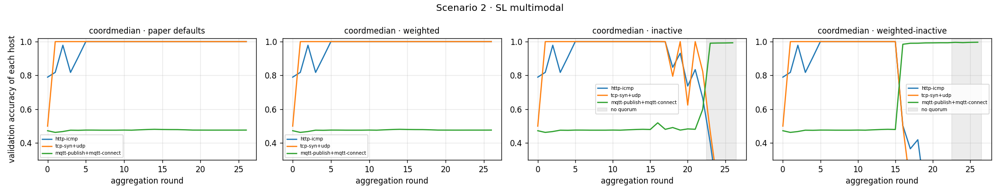

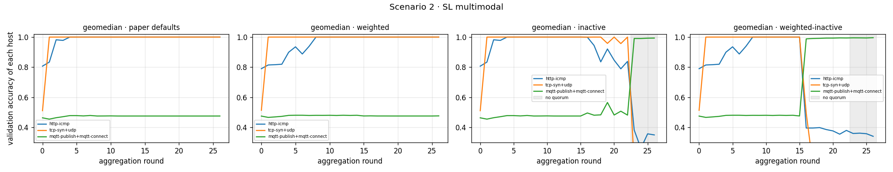

### Scenario 3 · multimodal

อัตราตรวจถูกต่อชนิดทราฟฟิก (%):

| merge | variant | Accuracy | F1 | test loss | รอบที่ merge | Benign | DDoS_HTTP | DDoS_ICMP | DDoS_TCP | DDoS_UDP | MQTT Connect | MQTT Publish |
|---|---|---|---|---|---|---|---|---|---|---|---|---|
| mean | เปเปอร์ (equal, snapshot) | 74.11 | 66.21 | 1.0000 | 18/18 | 99.60 | 10.57 | 100.00 | 100.00 | 99.96 | 1.92 | 2.26 |
| mean | ถ่วงด้วยจำนวนข้อมูล | 79.11 | 74.43 | 0.5843 | 18/18 | 99.53 | 59.15 | 100.00 | 100.00 | 99.99 | 18.03 | 5.47 |
| mean | inactive | 46.07 | 49.22 | 2.2769 | 16/18 | 40.75 | 43.86 | 0.03 | 100.00 | 0.00 | 99.28 | 59.16 |
| mean | ถ่วง + inactive | 52.85 | 58.31 | 2.3650 | 16/18 | 40.63 | 41.82 | 98.53 | 100.00 | 0.00 | 99.24 | 61.12 |
| coordmedian | เปเปอร์ (equal, snapshot) | 74.59 | 68.32 | 0.9860 | 18/18 | 96.42 | 31.21 | 100.00 | 100.00 | 100.00 | 6.82 | 6.33 |
| coordmedian | ถ่วงด้วยจำนวนข้อมูล | 78.55 | 73.41 | 1.3705 | 18/18 | 100.00 | 99.98 | 100.00 | 100.00 | 100.00 | 1.54 | 0.38 |
| coordmedian | inactive | 45.51 | 48.65 | 2.3462 | 16/18 | 40.24 | 41.97 | 0.00 | 99.14 | 0.00 | 99.13 | 56.91 |
| coordmedian | ถ่วง + inactive | 52.19 | 57.61 | 2.1198 | 16/18 | 40.24 | 37.82 | 99.97 | 98.10 | 0.00 | 98.96 | 57.49 |
| geomedian | เปเปอร์ (equal, snapshot) | 78.51 | 73.36 | 2.4194 | 18/18 | 99.99 | 100.00 | 100.00 | 100.00 | 100.00 | 1.37 | 0.27 |
| geomedian | ถ่วงด้วยจำนวนข้อมูล | 78.47 | 73.30 | 2.6713 | 18/18 | 99.98 | 100.00 | 100.00 | 100.00 | 100.00 | 1.17 | 0.17 |
| geomedian | inactive | 65.40 | 72.48 | 1.5952 | 16/18 | 40.54 | 49.55 | 100.00 | 100.00 | 99.74 | 98.63 | 58.69 |
| geomedian | ถ่วง + inactive | 63.30 | 70.29 | 1.4887 | 16/18 | 40.63 | 47.18 | 99.99 | 100.00 | 82.72 | 98.79 | 59.66 |

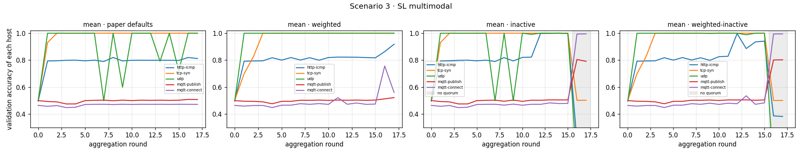

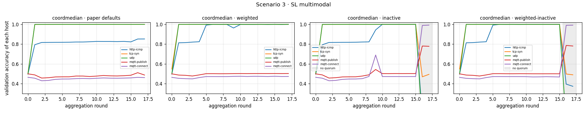

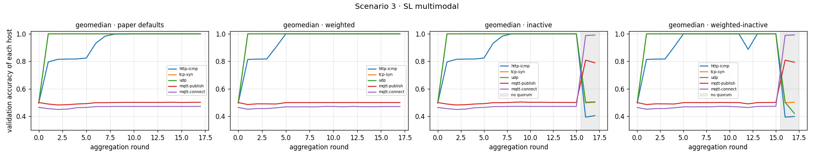

## บัญชีบน Fabric

ทุกรอบของ SL: ทุก node ส่ง sha256 ของ weights เข้า ledger (เซ็นด้วย cert ของ org ตัวเอง), chaincode เลือก leader, leader รวมเฉพาะ weights ที่ hash ตรง แล้วบันทึก hash ของโมเดลรวม, ทุก node ตรวจโมเดลที่ได้กับ hash บน ledger

| scenario | โมเดล | merge | variant | rounds (ปิดบน ledger) | leader (จำนวนรอบ) | ตรวจ hash ผ่าน | update ถูกปฏิเสธ | เวลา Fabric (s) | เวลาทั้งหมด (s) | upload (MB) |
|---|---|---|---|---|---|---|---|---|---|---|
| 1 | flow | coordmedian | — | 17 (17) | Org1 6, Org2 4, Org3 7 | 17/17 | 0 | 70 | 80 | 0.30 |
| 1 | flow | geomedian | — | 17 (17) | Org1 4, Org2 5, Org3 8 | 17/17 | 0 | 70 | 79 | 0.30 |
| 1 | flow | mean | — | 17 (17) | Org1 7, Org2 5, Org3 5 | 17/17 | 0 | 70 | 80 | 0.30 |
| 1 | multimodal | coordmedian | — | 17 (17) | Org1 6, Org2 4, Org3 7 | 17/17 | 0 | 70 | 110 | 4.89 |
| 1 | multimodal | geomedian | — | 17 (17) | Org1 4, Org2 5, Org3 8 | 17/17 | 0 | 70 | 111 | 4.89 |
| 1 | multimodal | mean | — | 17 (17) | Org1 7, Org2 5, Org3 5 | 17/17 | 0 | 70 | 110 | 4.89 |
| 1 | packet | coordmedian | — | 17 (17) | Org1 5, Org2 4, Org3 8 | 17/17 | 0 | 70 | 107 | 3.51 |
| 1 | packet | geomedian | — | 17 (17) | Org1 4, Org2 6, Org3 7 | 17/17 | 0 | 70 | 107 | 3.51 |
| 1 | packet | mean | — | 17 (17) | Org1 8, Org2 5, Org3 4 | 17/17 | 0 | 70 | 107 | 3.51 |
| 2 | flow | coordmedian | — | 27 (27) | Org1 7, Org2 9, Org3 11 | 27/27 | 0 | 111 | 129 | 0.48 |
| 2 | flow | geomedian | — | 27 (27) | Org1 8, Org2 7, Org3 12 | 27/27 | 0 | 111 | 129 | 0.48 |
| 2 | flow | mean | — | 27 (27) | Org1 12, Org2 6, Org3 9 | 27/27 | 0 | 111 | 129 | 0.48 |
| 2 | multimodal | coordmedian | — | 27 (27) | Org1 7, Org2 9, Org3 11 | 27/27 | 0 | 111 | 203 | 7.77 |
| 2 | multimodal | coordmedian | weighted | 27 (27) | Org1 10, Org2 9, Org3 8 | 27/27 | 0 | 112 | 206 | 7.77 |
| 2 | multimodal | coordmedian | inactive | 27 (23) | Org1 10, Org2 5, Org3 8 | 23/23 | 0 | 95 | 190 | 6.04 |
| 2 | multimodal | coordmedian | weighted-inactive | 27 (23) | Org1 5, Org2 9, Org3 9 | 23/23 | 0 | 95 | 191 | 5.90 |
| 2 | multimodal | geomedian | — | 27 (27) | Org1 8, Org2 7, Org3 12 | 27/27 | 0 | 111 | 204 | 7.77 |
| 2 | multimodal | geomedian | weighted | 27 (27) | Org1 7, Org2 11, Org3 9 | 27/27 | 0 | 112 | 210 | 7.77 |
| 2 | multimodal | geomedian | inactive | 27 (23) | Org1 7, Org2 8, Org3 8 | 23/23 | 0 | 95 | 191 | 6.04 |
| 2 | multimodal | geomedian | weighted-inactive | 27 (23) | Org1 9, Org2 5, Org3 9 | 23/23 | 0 | 95 | 192 | 6.18 |
| 2 | multimodal | mean | — | 27 (27) | Org1 12, Org2 6, Org3 9 | 27/27 | 0 | 111 | 203 | 7.77 |
| 2 | multimodal | mean | weighted | 27 (27) | Org1 11, Org2 7, Org3 9 | 27/27 | 0 | 112 | 206 | 7.77 |
| 2 | multimodal | mean | inactive | 27 (23) | Org1 7, Org2 5, Org3 11 | 23/23 | 0 | 95 | 190 | 6.04 |
| 2 | multimodal | mean | weighted-inactive | 27 (23) | Org1 9, Org2 8, Org3 6 | 23/23 | 0 | 95 | 191 | 6.04 |
| 2 | packet | coordmedian | — | 27 (27) | Org1 7, Org2 9, Org3 11 | 27/27 | 0 | 111 | 197 | 5.57 |
| 2 | packet | geomedian | — | 27 (27) | Org1 8, Org2 7, Org3 12 | 27/27 | 0 | 111 | 198 | 5.57 |
| 2 | packet | mean | — | 27 (27) | Org1 12, Org2 6, Org3 9 | 27/27 | 0 | 111 | 198 | 5.57 |
| 3 | flow | coordmedian | — | 18 (18) | Org1 6, Org2 5, Org3 2, Org4 3, Org5 2 | 18/18 | 0 | 75 | 89 | 0.65 |
| 3 | flow | geomedian | — | 18 (18) | Org1 4, Org2 5, Org3 2, Org4 4, Org5 3 | 18/18 | 0 | 74 | 89 | 0.65 |
| 3 | flow | mean | — | 18 (18) | Org1 5, Org2 3, Org3 3, Org4 3, Org5 4 | 18/18 | 0 | 75 | 89 | 0.65 |
| 3 | multimodal | coordmedian | — | 18 (18) | Org1 6, Org2 5, Org3 2, Org4 3, Org5 2 | 18/18 | 0 | 75 | 162 | 10.36 |
| 3 | multimodal | coordmedian | weighted | 18 (18) | Org1 2, Org3 8, Org4 3, Org5 5 | 18/18 | 0 | 75 | 232 | 10.36 |
| 3 | multimodal | coordmedian | inactive | 18 (16) | Org1 4, Org2 1, Org3 4, Org4 3, Org5 4 | 16/16 | 0 | 67 | 159 | 7.62 |
| 3 | multimodal | coordmedian | weighted-inactive | 18 (16) | Org1 6, Org2 2, Org3 5, Org4 2, Org5 1 | 16/16 | 0 | 66 | 161 | 7.48 |
| 3 | multimodal | geomedian | — | 18 (18) | Org1 4, Org2 5, Org3 2, Org4 4, Org5 3 | 18/18 | 0 | 75 | 163 | 10.36 |
| 3 | multimodal | geomedian | weighted | 18 (18) | Org1 5, Org2 5, Org3 4, Org4 2, Org5 2 | 18/18 | 0 | 75 | 234 | 10.36 |
| 3 | multimodal | geomedian | inactive | 18 (16) | Org1 4, Org2 3, Org3 3, Org4 2, Org5 4 | 16/16 | 0 | 67 | 224 | 7.62 |
| 3 | multimodal | geomedian | weighted-inactive | 18 (16) | Org1 4, Org2 6, Org3 2, Org4 3, Org5 1 | 16/16 | 0 | 66 | 236 | 7.77 |
| 3 | multimodal | mean | — | 18 (18) | Org1 5, Org2 3, Org3 3, Org4 3, Org5 4 | 18/18 | 0 | 75 | 162 | 10.36 |
| 3 | multimodal | mean | weighted | 18 (18) | Org1 7, Org2 2, Org3 4, Org4 2, Org5 3 | 18/18 | 0 | 75 | 166 | 10.36 |
| 3 | multimodal | mean | inactive | 18 (16) | Org1 3, Org2 4, Org3 3, Org4 3, Org5 3 | 16/16 | 0 | 67 | 158 | 7.77 |
| 3 | multimodal | mean | weighted-inactive | 18 (16) | Org1 4, Org2 3, Org4 4, Org5 5 | 16/16 | 0 | 66 | 161 | 7.48 |
| 3 | packet | coordmedian | — | 18 (18) | Org1 6, Org2 5, Org3 2, Org4 3, Org5 2 | 18/18 | 0 | 75 | 157 | 7.42 |
| 3 | packet | geomedian | — | 18 (18) | Org1 4, Org2 5, Org3 2, Org4 4, Org5 3 | 18/18 | 0 | 75 | 157 | 7.42 |
| 3 | packet | mean | — | 18 (18) | Org1 5, Org2 3, Org3 3, Org4 3, Org5 4 | 18/18 | 0 | 75 | 157 | 7.42 |

## ข้อมูลที่เตรียม (`data/processed/prepare.json`)

```json
{
 "edge_rows_after_dedup": {
  "Normal": 1363998,
  "DDoS_UDP": 121567,
  "DDoS_ICMP": 67939,
  "DDoS_TCP": 50062,
  "DDoS_HTTP": 48544
 },
 "edge_rows_paired": {
  "Normal": 1095596,
  "DDoS_UDP": 121565,
  "DDoS_ICMP": 67936,
  "DDoS_TCP": 50061,
  "DDoS_HTTP": 48541
 },
 "ciciomt": {
  "Benign": {
   "ipv4_packets": 2257456,
   "after_dedup": 2175850,
   "drawn": 193416
  },
  "MQTT-DDoS-Connect_Flood": {
   "ipv4_packets": 21485405,
   "after_dedup": 15797377,
   "drawn": 147166
  },
  "MQTT-DDoS-Publish_Flood": {
   "ipv4_packets": 3594073,
   "after_dedup": 2936167,
   "drawn": 65835
  }
 },
 "units": {
  "http-icmp": {
   "Benign": {
    "test": 11484,
    "train": 93016,
    "val": 10335
   },
   "DDoS_HTTP": {
    "test": 4854,
    "train": 39318,
    "val": 4369
   },
   "DDoS_ICMP": {
    "test": 6794,
    "train": 55028,
    "val": 6114
   }
  },
  "tcp-syn": {
   "Benign": {
    "test": 5079,
    "train": 41141,
    "val": 4571
   },
   "DDoS_TCP": {
    "test": 5006,
    "train": 40549,
    "val": 4506
   }
  },
  "udp": {
   "Benign": {
    "test": 12117,
    "train": 98149,
    "val": 10905
   },
   "DDoS_UDP": {
    "test": 12156,
    "train": 98468,
    "val": 10941
   }
  },
  "mqtt-publish": {
   "Benign": {
    "test": 6585,
    "train": 53337,
    "val": 5926
   },
   "MQTT-DDoS-Publish_Flood": {
    "test": 6584,
    "train": 53326,
    "val": 5925
   }
  },
  "mqtt-connect": {
   "Benign": {
    "test": 12757,
    "train": 103330,
    "val": 11481
   },
   "MQTT-DDoS-Connect_Flood": {
    "test": 14717,
    "train": 119204,
    "val": 13245
   }
  }
 }
}
```
