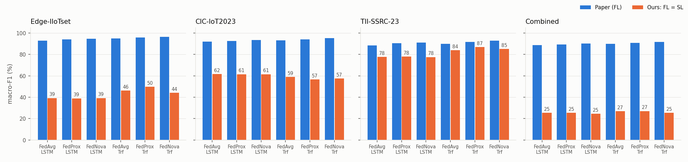
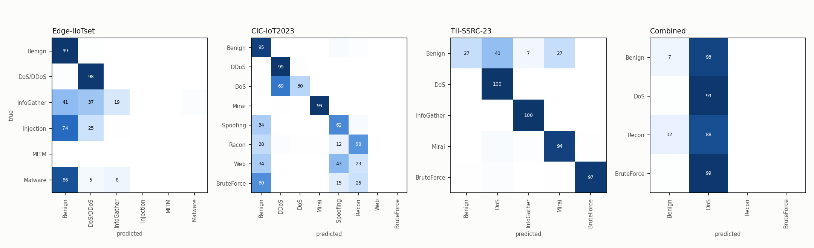
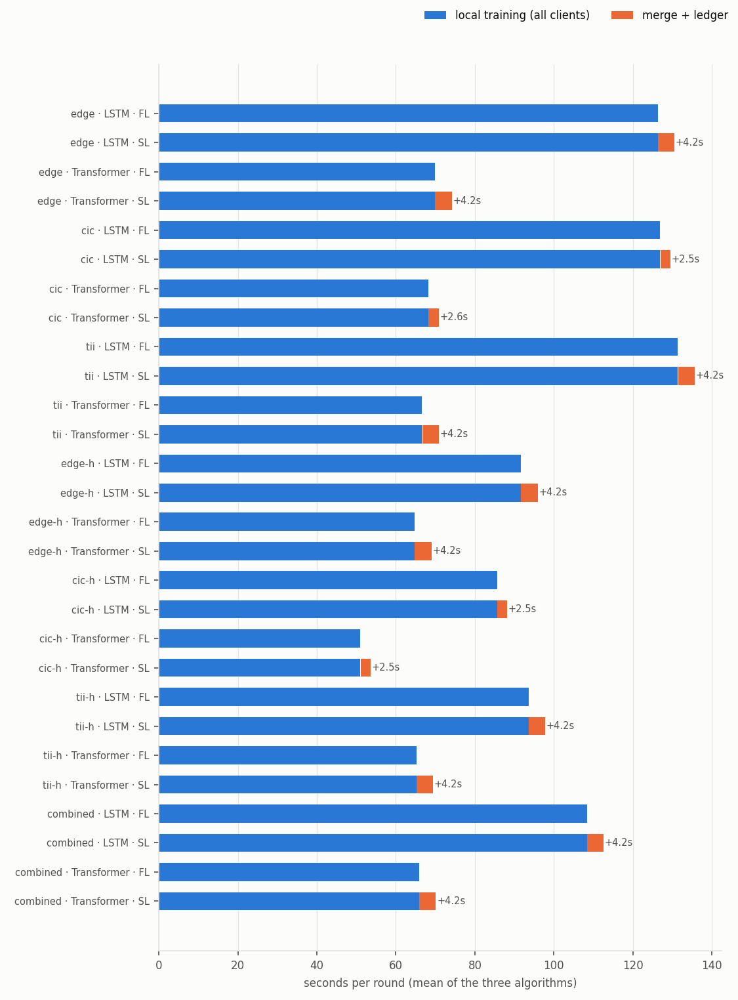
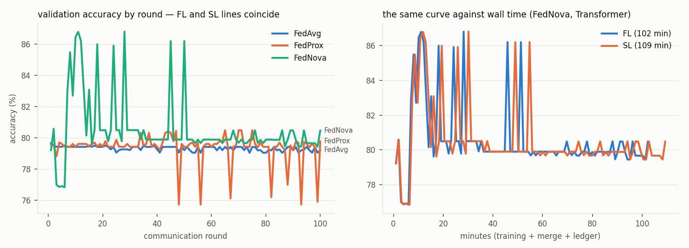

# ผลการทดลอง: FL เทียบ SL บนโจทย์ของ Bilal et al. (2026)

> สร้างโดย `python report.py results/full-500k` จากไฟล์ใน `runs/` ของโฟลเดอร์นี้ ทุกตัวเลขในหน้านี้อ่านจากไฟล์ผล ส่วนตัวเลขของเปเปอร์คัดจาก Tables 5–9

ข้อมูล: ฉบับเต็มของทั้งสามชุดตามเปเปอร์ สุ่ม 500,000 แถวต่อ scenario ตามสัดส่วนจริงของแต่ละชุด

## ชุดทดลองที่รัน

| Scenario | clients | แถวที่สุ่มมา | แถวเทรน | features | classes | rounds |
|---|---|---|---|---|---|---|
| edge | 6 | 500,000 | 359,980 | 39 | 6 (Benign, DoS/DDoS, InfoGather, Injection, MITM, Malware) | 50 |
| cic | 10 | 500,000 | 359,968 | 46 | 8 (Benign, DDoS, DoS, Mirai, Spoofing, Recon, Web, BruteForce) | 50 |
| tii | 5 | 500,000 | 359,989 | 77 | 5 (Benign, DoS, InfoGather, Mirai, BruteForce) | 50 |
| edge-h | 6 | 500,000 | 349,199 | 10 | 4 (Benign, DoS, Recon, BruteForce) | 50 |
| cic-h | 10 | 500,000 | 335,723 | 10 | 4 (Benign, DoS, Recon, BruteForce) | 50 |
| tii-h | 5 | 500,000 | 356,205 | 10 | 4 (Benign, DoS, Recon, BruteForce) | 50 |
| combined | 3 | 499,998 | 359,983 | 10 | 4 (Benign, DoS, Recon, BruteForce) | 100 |

ทุก run ใช้ E = 5, batch 128, Adam (weight decay 0.0001), μ = 0.001 สำหรับ FedProx, lr 0.001 (LSTM) / 0.0005 (Transformer) ตาม Table 4

Scenario ที่รันด้วย `--flush-denormal` (ทั้ง FL และ SL): cic, cic-h, combined, edge, edge-h, tii, tii-h — ค่าที่เล็กกว่า 1e-38 ถูกปัดเป็นศูนย์เพื่อความเร็ว ต่างจากไม่ปัดแค่บิตท้ายๆ (ดู README)

## 1. FL กับ SL ได้โมเดลเดียวกันไหม

| คู่ FL/SL ที่เทียบ | โมเดลสุดท้ายเหมือนกันทุกบิต | รอบที่ global model เหมือนกันทุกบิต | รอบ SL ที่ทุกโหนดตรวจ hash กับ ledger ผ่าน | update ที่ leader ปฏิเสธ |
|---|---|---|---|---|
| 42 | 42 / 42 | 2400 / 2400 | 2400 / 2400 | 0 |

**ได้โมเดลเดียวกันทุกบิตในทุกคู่** ข้อมูล seed และสูตร aggregation เหมือนกัน สิ่งที่ SL เปลี่ยนคือใครเป็นคนรวมโมเดล (leader ที่ chaincode เลือก แทน server) และการบันทึก/ตรวจสอบบน ledger ซึ่งไม่แตะตัวเลขของโมเดลเลย ความแม่นยำของ FL และ SL จึงเท่ากันพอดี ความต่างอยู่ที่ต้นทุน (หัวข้อ 3) และความน่าเชื่อถือ (README)

ชุดนี้เทรน client ครั้งเดียวต่อรอบ แล้วส่ง update ชุดเดียวกันให้ server ของ FL และ swarm ของ SL ไปรวมแยกกัน ทุกรอบเช็กว่าทั้งสองทางได้ global model เดียวกันทุกบิต run จะหยุดทันทีถ้าไม่ตรงกัน เวลาเทรนของ FL กับ SL ในหัวข้อ 3 จึงเป็นตัวเลขเดียวกัน ต่างกันที่เวลารวมโมเดลกับเวลาที่รอ Fabric

## 2. ความแม่นยำบนชุดทดสอบ (Tables 5–8)

ค่าเป็น % · Precision / Recall / F1 เป็น macro · AUC เป็น macro one-vs-rest · คอลัมน์ Paper คือตัวเลขในเปเปอร์ (FL ทั้งหมด)

### edge — Edge-IIoTset

| Model | Algorithm | Paper Acc | Paper F1 | Paper AUC | FL Acc | FL Prec | FL Rec | FL F1 | FL AUC | SL Acc | SL F1 | SL AUC | FL = SL |
|---|---|---|---|---|---|---|---|---|---|---|---|---|---|
| LSTM | FedAvg | 96.0 | 93.0 | 97.5 | 89.4 | 48.1 | 40.3 | **39.1** | 90.3 | 89.4 | **39.1** | 90.3 | ใช่ |
| LSTM | FedProx | 96.5 | 94.0 | 97.8 | 89.3 | 49.1 | 40.1 | **38.9** | 91.0 | 89.3 | **38.9** | 91.0 | ใช่ |
| LSTM | FedNova | 97.0 | 94.7 | 98.0 | 89.4 | 48.1 | 40.3 | **39.1** | 90.3 | 89.4 | **39.1** | 90.3 | ใช่ |
| Transformer | FedAvg | 97.0 | 95.0 | 98.0 | 90.2 | 54.0 | 44.9 | **46.2** | 90.8 | 90.2 | **46.2** | 90.8 | ใช่ |
| Transformer | FedProx | 97.5 | 95.7 | 98.5 | 91.4 | 54.9 | 48.1 | **49.7** | 90.5 | 91.4 | **49.7** | 90.5 | ใช่ |
| Transformer | FedNova | 98.0 | 96.5 | 99.0 | 90.2 | 53.7 | 43.3 | **44.1** | 91.2 | 90.2 | **44.1** | 91.2 | ใช่ |

### cic — CIC-IoT2023

| Model | Algorithm | Paper Acc | Paper F1 | Paper AUC | FL Acc | FL Prec | FL Rec | FL F1 | FL AUC | SL Acc | SL F1 | SL AUC | FL = SL |
|---|---|---|---|---|---|---|---|---|---|---|---|---|---|
| LSTM | FedAvg | 95.0 | 92.0 | 96.0 | 89.0 | 62.4 | 61.3 | **61.5** | 97.5 | 89.0 | **61.5** | 97.5 | ใช่ |
| LSTM | FedProx | 95.5 | 92.7 | 96.5 | 88.9 | 62.5 | 61.2 | **61.5** | 97.7 | 88.9 | **61.5** | 97.7 | ใช่ |
| LSTM | FedNova | 96.0 | 93.5 | 97.0 | 89.3 | 62.5 | 61.2 | **61.5** | 97.4 | 89.3 | **61.5** | 97.4 | ใช่ |
| Transformer | FedAvg | 96.0 | 93.2 | 97.0 | 88.0 | 64.2 | 57.0 | **59.0** | 98.6 | 88.0 | **59.0** | 98.6 | ใช่ |
| Transformer | FedProx | 96.5 | 94.2 | 97.5 | 85.4 | 62.2 | 54.9 | **56.6** | 98.0 | 85.4 | **56.6** | 98.0 | ใช่ |
| Transformer | FedNova | 97.0 | 95.2 | 98.0 | 86.5 | 64.0 | 55.5 | **57.4** | 99.0 | 86.5 | **57.4** | 99.0 | ใช่ |

### tii — TII-SSRC-23

| Model | Algorithm | Paper Acc | Paper F1 | Paper AUC | FL Acc | FL Prec | FL Rec | FL F1 | FL AUC | SL Acc | SL F1 | SL AUC | FL = SL |
|---|---|---|---|---|---|---|---|---|---|---|---|---|---|
| LSTM | FedAvg | 92.0 | 88.5 | 94.0 | 99.8 | 77.1 | 78.1 | **77.6** | 97.8 | 99.8 | **77.6** | 97.8 | ใช่ |
| LSTM | FedProx | 93.0 | 90.5 | 95.0 | 99.8 | 78.1 | 78.0 | **78.0** | 96.2 | 99.8 | **78.0** | 96.2 | ใช่ |
| LSTM | FedNova | 93.5 | 91.2 | 95.5 | 99.8 | 77.0 | 78.1 | **77.5** | 97.7 | 99.8 | **77.5** | 97.7 | ใช่ |
| Transformer | FedAvg | 93.0 | 90.0 | 95.0 | 99.8 | 88.4 | 82.1 | **83.9** | 99.0 | 99.8 | **83.9** | 99.0 | ใช่ |
| Transformer | FedProx | 94.0 | 91.7 | 96.0 | 99.8 | 90.5 | 84.9 | **86.8** | 99.5 | 99.8 | **86.8** | 99.5 | ใช่ |
| Transformer | FedNova | 95.0 | 93.0 | 97.0 | 99.8 | 88.1 | 83.5 | **85.1** | 98.7 | 99.8 | **85.1** | 98.7 | ใช่ |

### edge-h

| Model | Algorithm | FL Acc | FL Prec | FL Rec | FL F1 | FL AUC | SL Acc | SL F1 | SL AUC | FL = SL |
|---|---|---|---|---|---|---|---|---|---|---|
| LSTM | FedAvg | 89.1 | 44.6 | 48.0 | **46.2** | 87.0 | 89.1 | **46.2** | 87.0 | ใช่ |
| LSTM | FedProx | 86.4 | 44.4 | 45.5 | **44.7** | 87.8 | 86.4 | **44.7** | 87.8 | ใช่ |
| LSTM | FedNova | 87.3 | 44.3 | 46.4 | **45.2** | 87.2 | 87.3 | **45.2** | 87.2 | ใช่ |
| Transformer | FedAvg | 89.1 | 44.6 | 48.0 | **46.2** | 89.4 | 89.1 | **46.2** | 89.4 | ใช่ |
| Transformer | FedProx | 89.1 | 44.6 | 48.0 | **46.2** | 88.7 | 89.1 | **46.2** | 88.7 | ใช่ |
| Transformer | FedNova | 89.1 | 44.6 | 48.0 | **46.2** | 89.2 | 89.1 | **46.2** | 89.2 | ใช่ |

### cic-h

| Model | Algorithm | FL Acc | FL Prec | FL Rec | FL F1 | FL AUC | SL Acc | SL F1 | SL AUC | FL = SL |
|---|---|---|---|---|---|---|---|---|---|---|
| LSTM | FedAvg | 98.4 | 58.5 | 48.8 | **49.4** | 93.9 | 98.4 | **49.4** | 93.9 | ใช่ |
| LSTM | FedProx | 98.4 | 58.5 | 48.8 | **49.4** | 93.9 | 98.4 | **49.4** | 93.9 | ใช่ |
| LSTM | FedNova | 98.4 | 58.5 | 48.8 | **49.4** | 93.9 | 98.4 | **49.4** | 93.9 | ใช่ |
| Transformer | FedAvg | 98.4 | 58.5 | 48.8 | **49.4** | 93.9 | 98.4 | **49.4** | 93.9 | ใช่ |
| Transformer | FedProx | 98.4 | 58.5 | 48.8 | **49.4** | 93.5 | 98.4 | **49.4** | 93.5 | ใช่ |
| Transformer | FedNova | 98.4 | 58.5 | 48.8 | **49.4** | 93.9 | 98.4 | **49.4** | 93.9 | ใช่ |

### tii-h

| Model | Algorithm | FL Acc | FL Prec | FL Rec | FL F1 | FL AUC | SL Acc | SL F1 | SL AUC | FL = SL |
|---|---|---|---|---|---|---|---|---|---|---|
| LSTM | FedAvg | 87.5 | 40.8 | 33.2 | **34.8** | 85.6 | 87.5 | **34.8** | 85.6 | ใช่ |
| LSTM | FedProx | 87.6 | 41.7 | 33.0 | **34.7** | 86.3 | 87.6 | **34.7** | 86.3 | ใช่ |
| LSTM | FedNova | 87.6 | 41.9 | 33.0 | **34.7** | 85.9 | 87.6 | **34.7** | 85.9 | ใช่ |
| Transformer | FedAvg | 87.6 | 56.7 | 38.2 | **42.4** | 85.6 | 87.6 | **42.4** | 85.6 | ใช่ |
| Transformer | FedProx | 87.6 | 57.0 | 38.0 | **42.3** | 85.9 | 87.6 | **42.3** | 85.9 | ใช่ |
| Transformer | FedNova | 87.6 | 56.6 | 38.2 | **42.4** | 85.9 | 87.6 | **42.4** | 85.9 | ใช่ |

### combined — Combined

| Model | Algorithm | Paper Acc | Paper F1 | Paper AUC | FL Acc | FL Prec | FL Rec | FL F1 | FL AUC | SL Acc | SL F1 | SL AUC | FL = SL |
|---|---|---|---|---|---|---|---|---|---|---|---|---|---|
| LSTM | FedAvg | 91.5 | 88.6 | 96.2 | 80.4 | 33.0 | 26.5 | **25.4** | 69.1 | 80.4 | **25.4** | 69.1 | ใช่ |
| LSTM | FedProx | 92.1 | 89.4 | 96.6 | 80.4 | 33.0 | 26.5 | **25.4** | 79.1 | 80.4 | **25.4** | 79.1 | ใช่ |
| LSTM | FedNova | 93.0 | 90.3 | 97.0 | 77.3 | 25.7 | 25.6 | **24.5** | 80.6 | 77.3 | **24.5** | 80.6 | ใช่ |
| Transformer | FedAvg | 92.7 | 89.9 | 97.1 | 79.2 | 29.8 | 27.2 | **26.8** | 74.4 | 79.2 | **26.8** | 74.4 | ใช่ |
| Transformer | FedProx | 93.4 | 90.9 | 97.5 | 79.8 | 31.1 | 27.4 | **27.0** | 71.7 | 79.8 | **27.0** | 71.7 | ใช่ |
| Transformer | FedNova | 94.2 | 91.7 | 98.0 | 80.5 | 34.2 | 26.6 | **25.4** | 70.9 | 80.5 | **25.4** | 70.9 | ใช่ |

### ข้อมูลชุดนี้มีสัญญาณให้เรียนแค่ไหน (ไม่ใช่ส่วนของเปเปอร์)

Gradient boosting แบบรวมศูนย์บน feature, split และ scaler ต่อ client ชุดเดียวกับทุก run ใช้เป็นเพดานอ้างอิงว่า feature เหล่านี้แยกคลาสได้แค่ไหน — ถ้า federated model ต่ำกว่าเพดานมาก คือการเรียนแบบกระจายเสียไป ถ้าเพดานเองต่ำ คือข้อมูลมีให้เรียนน้อย

| Scenario | boosting Acc | boosting macro-F1 | majority-class Acc |
|---|---|---|---|
| edge | 98.0 | 91.1 | 54.0 |
| cic | 98.9 | 67.5 | 72.8 |
| tii | 99.6 | 76.1 | 86.5 |
| edge-h | 91.8 | 65.1 | 55.7 |
| cic-h | 98.4 | 48.8 | 96.7 |
| tii-h | 87.2 | 33.7 | 87.5 |
| combined | 94.8 | 47.4 | 80.0 |

Confusion matrix (Transformer + FedNova, normalise ตามแถว, ค่า % · FL = SL):

## 3. ต้นทุนของแต่ละสถาปัตยกรรม

ต่อรอบ เฉลี่ยสาม algorithm · MB/round ของ FL ใช้สูตรเดียวกับ Table 9 (2 × clients × parameters × 4 bytes) · SL ส่งระหว่างโหนดโดยตรง leader ไม่ต้องส่ง update ของตัวเอง · เวลาเทรนรันขนานหลาย lane บน CPU เครื่องเดียว จึงเทียบกันได้ภายในตารางเดียวกันเท่านั้น

| Scenario | Model | clients | FL train s/round | SL train s/round | SL ledger s/round | SL ledger ÷ round | FL MB/round | SL MB/round | ledger tx/round |
|---|---|---|---|---|---|---|---|---|---|
| edge | LSTM | 6 | 126.3 | 126.3 | 4.22 | 3% | 1.95 | 1.63 | 7 |
| edge | Transformer | 6 | 69.9 | 69.9 | 4.22 | 6% | 3.27 | 2.72 | 7 |
| cic | LSTM | 10 | 126.9 | 126.9 | 2.51 | 2% | 3.40 | 3.06 | 11 |
| cic | Transformer | 10 | 68.2 | 68.2 | 2.57 | 4% | 5.46 | 4.92 | 11 |
| tii | LSTM | 5 | 131.4 | 131.4 | 4.18 | 3% | 2.01 | 1.61 | 6 |
| tii | Transformer | 5 | 66.6 | 66.6 | 4.20 | 6% | 2.74 | 2.20 | 6 |
| edge-h | LSTM | 6 | 91.6 | 91.6 | 4.23 | 4% | 1.59 | 1.33 | 7 |
| edge-h | Transformer | 6 | 64.7 | 64.7 | 4.24 | 6% | 3.24 | 2.70 | 7 |
| cic-h | LSTM | 10 | 85.6 | 85.6 | 2.51 | 3% | 2.66 | 2.39 | 11 |
| cic-h | Transformer | 10 | 51.0 | 51.0 | 2.51 | 5% | 5.40 | 4.86 | 11 |
| tii-h | LSTM | 5 | 93.6 | 93.6 | 4.19 | 4% | 1.33 | 1.06 | 6 |
| tii-h | Transformer | 5 | 65.2 | 65.2 | 4.21 | 6% | 2.70 | 2.16 | 6 |
| combined | LSTM | 3 | 108.4 | 108.4 | 4.16 | 4% | 0.80 | 0.53 | 4 |
| combined | Transformer | 3 | 65.9 | 65.9 | 4.17 | 6% | 1.62 | 1.08 | 4 |

### Table 9 — combined federation

| Model | Algorithm | Paper rounds→95% | Paper MB | Paper min | rounds→95% (FL = SL) | FL MB | SL MB | FL min | SL min | SL ledger min |
|---|---|---|---|---|---|---|---|---|---|---|
| LSTM | FedAvg | - | - | - | ไม่ถึง | 80 | 53 | 182.7 | 189.6 | 6.9 |
| LSTM | FedProx | - | - | - | ไม่ถึง | 80 | 53 | 169.8 | 176.7 | 6.9 |
| LSTM | FedNova | - | - | - | ไม่ถึง | 80 | 53 | 189.7 | 196.6 | 6.9 |
| Transformer | FedAvg | 50 | 1500 | 100 | ไม่ถึง | 162 | 108 | 104.8 | 111.7 | 6.9 |
| Transformer | FedProx | 55 | 1650 | 110 | ไม่ถึง | 162 | 108 | 122.5 | 129.4 | 7.0 |
| Transformer | FedNova | 40 | 1200 | 80 | ไม่ถึง | 162 | 108 | 102.3 | 109.3 | 7.0 |

## 4. ข้ามชุดข้อมูล (Section 5.3)

macro-F1 (%) เฉลี่ยสาม algorithm · แถว = ชุดที่ใช้เทรน (schema ร่วม 10 features, 4 classes) · คอลัมน์ = ชุดที่ใช้ทดสอบ · ทแยง = ทดสอบในชุดเดียวกัน · Combined = โมเดลที่เทรนรวมทุกชุด ทดสอบกับ test split ของแต่ละชุด

| LSTM: train ↓ / test → | Edge-IIoTset | CIC-IoT2023 | TII-SSRC-23 |
|---|---|---|---|
| Edge-IIoTset | 45.4 | 21.8 | 5.1 |
| CIC-IoT2023 | 31.8 | 49.4 | 23.1 |
| TII-SSRC-23 | 15.8 | 23.3 | 34.7 |
| **Combined** | 14.3 | 39.5 | 23.0 |

| Transformer: train ↓ / test → | Edge-IIoTset | CIC-IoT2023 | TII-SSRC-23 |
|---|---|---|---|
| Edge-IIoTset | 46.2 | 24.3 | 6.1 |
| CIC-IoT2023 | 31.8 | 49.4 | 23.1 |
| TII-SSRC-23 | 11.7 | 20.7 | 42.4 |
| **Combined** | 15.2 | 43.7 | 22.7 |

