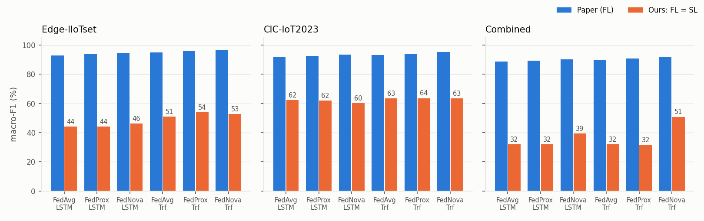
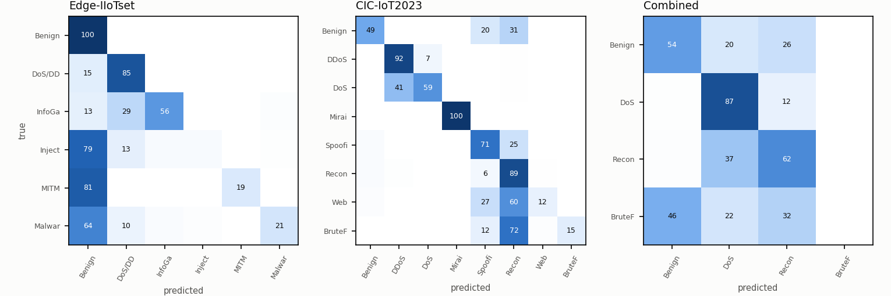
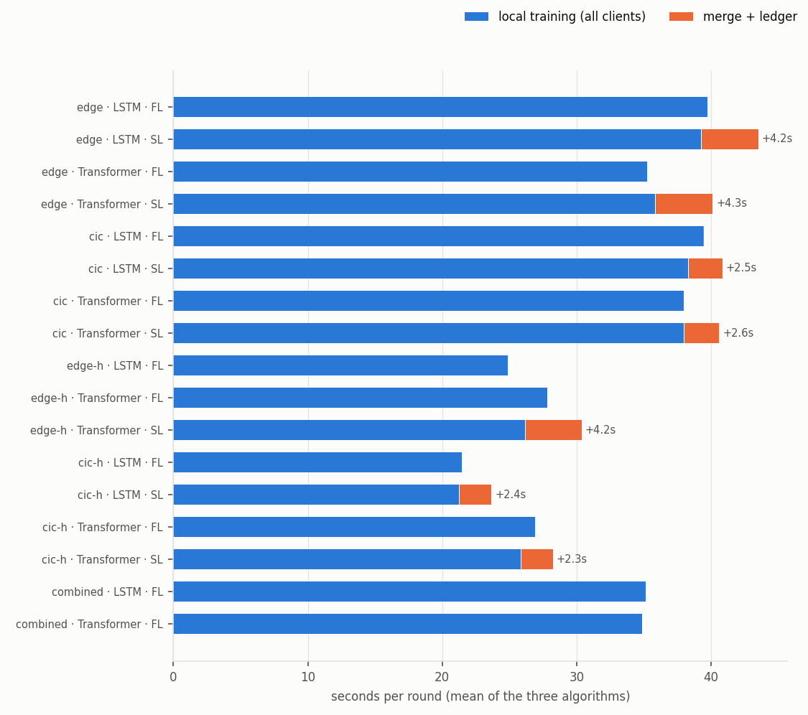

# ผลการทดลอง: FL เทียบ SL บนโจทย์ของ Bilal et al. (2026)

> สร้างโดย `python report.py` จากไฟล์ใน `results/runs/` ทุกตัวเลขในหน้านี้อ่านจากไฟล์ผล ส่วนตัวเลขของเปเปอร์คัดจาก Tables 5–9

ข้อมูลที่มี: Edge-IIoTset, CIC-IoT2023 — **ยังไม่มี TII-SSRC-23** (ดู README) ชุด combined จึงมี 2 client แทน 3

## ชุดทดลองที่รัน

| Scenario | clients | แถวที่สุ่มมา | แถวเทรน | features | classes | rounds |
|---|---|---|---|---|---|---|
| edge | 6 | 45,001 | 32,390 | 39 | 6 (Benign, DoS/DDoS, InfoGather, Injection, MITM, Malware) | 50 |
| cic | 10 | 50,000 | 35,965 | 46 | 8 (Benign, DDoS, DoS, Mirai, Spoofing, Recon, Web, BruteForce) | 50 |
| edge-h | 6 | 45,001 | 28,920 | 10 | 4 (Benign, DoS, Recon, BruteForce) | 50 |
| cic-h | 10 | 50,000 | 28,136 | 10 | 4 (Benign, DoS, Recon, BruteForce) | 50 |
| combined | 2 | 49,999 | 35,995 | 10 | 4 (Benign, DoS, Recon, BruteForce) | 100 |

ทุก run ใช้ E = 5, batch 128, Adam (weight decay 0.0001), μ = 0.001 สำหรับ FedProx, lr 0.001 (LSTM) / 0.0005 (Transformer) ตาม Table 4

## 1. FL กับ SL ได้โมเดลเดียวกันไหม

| คู่ FL/SL ที่เทียบ | โมเดลสุดท้ายเหมือนกันทุกบิต | รอบที่ global model เหมือนกันทุกบิต | รอบ SL ที่ทุกโหนดตรวจ hash กับ ledger ผ่าน | update ที่ leader ปฏิเสธ |
|---|---|---|---|---|
| 21 | 21 / 21 | 1050 / 1050 | 1050 / 1050 | 0 |

**ได้โมเดลเดียวกันทุกบิตในทุกคู่** ข้อมูล seed และสูตร aggregation เหมือนกัน สิ่งที่ SL เปลี่ยนคือใครเป็นคนรวมโมเดล (leader ที่ chaincode เลือก แทน server) และการบันทึก/ตรวจสอบบน ledger ซึ่งไม่แตะตัวเลขของโมเดลเลย ความแม่นยำของ FL และ SL จึงเท่ากันพอดี ความต่างอยู่ที่ต้นทุน (หัวข้อ 3) และความน่าเชื่อถือ (README)

## 2. ความแม่นยำบนชุดทดสอบ (Tables 5–8)

ค่าเป็น % · Precision / Recall / F1 เป็น macro · AUC เป็น macro one-vs-rest · คอลัมน์ Paper คือตัวเลขในเปเปอร์ (FL ทั้งหมด)

### edge — Edge-IIoTset

| Model | Algorithm | Paper Acc | Paper F1 | Paper AUC | FL Acc | FL Prec | FL Rec | FL F1 | FL AUC | SL Acc | SL F1 | SL AUC | FL = SL |
|---|---|---|---|---|---|---|---|---|---|---|---|---|---|
| LSTM | FedAvg | 96.0 | 93.0 | 97.5 | 78.9 | 56.8 | 41.9 | **44.0** | 87.6 | 78.9 | **44.0** | 87.6 | ใช่ |
| LSTM | FedProx | 96.5 | 94.0 | 97.8 | 78.9 | 57.6 | 41.8 | **44.0** | 90.0 | 78.9 | **44.0** | 90.0 | ใช่ |
| LSTM | FedNova | 97.0 | 94.7 | 98.0 | 79.2 | 72.9 | 43.0 | **46.2** | 88.6 | 79.2 | **46.2** | 88.6 | ใช่ |
| Transformer | FedAvg | 97.0 | 95.0 | 98.0 | 81.4 | 81.1 | 46.5 | **50.8** | 92.9 | 81.4 | **50.8** | 92.9 | ใช่ |
| Transformer | FedProx | 97.5 | 95.7 | 98.5 | 81.8 | 82.8 | 48.8 | **53.9** | 93.0 | 81.8 | **53.9** | 93.0 | ใช่ |
| Transformer | FedNova | 98.0 | 96.5 | 99.0 | 81.7 | 85.3 | 47.5 | **52.6** | 93.3 | 81.7 | **52.6** | 93.3 | ใช่ |

### cic — CIC-IoT2023

| Model | Algorithm | Paper Acc | Paper F1 | Paper AUC | FL Acc | FL Prec | FL Rec | FL F1 | FL AUC | SL Acc | SL F1 | SL AUC | FL = SL |
|---|---|---|---|---|---|---|---|---|---|---|---|---|---|
| LSTM | FedAvg | 95.0 | 92.0 | 96.0 | 81.9 | 78.5 | 59.3 | **62.1** | 97.3 | 81.9 | **62.1** | 97.3 | ใช่ |
| LSTM | FedProx | 95.5 | 92.7 | 96.5 | 81.6 | 81.4 | 59.0 | **61.8** | 97.3 | 81.6 | **61.8** | 97.3 | ใช่ |
| LSTM | FedNova | 96.0 | 93.5 | 97.0 | 81.9 | 78.5 | 58.0 | **60.1** | 97.3 | 81.9 | **60.1** | 97.3 | ใช่ |
| Transformer | FedAvg | 96.0 | 93.2 | 97.0 | 82.6 | 77.7 | 60.9 | **63.5** | 97.5 | 82.6 | **63.5** | 97.5 | ใช่ |
| Transformer | FedProx | 96.5 | 94.2 | 97.5 | 82.8 | 78.2 | 60.9 | **63.6** | 97.5 | 82.8 | **63.6** | 97.5 | ใช่ |
| Transformer | FedNova | 97.0 | 95.2 | 98.0 | 82.7 | 79.1 | 60.9 | **63.5** | 97.5 | 82.7 | **63.5** | 97.5 | ใช่ |

### edge-h

| Model | Algorithm | FL Acc | FL Prec | FL Rec | FL F1 | FL AUC | SL Acc | SL F1 | SL AUC | FL = SL |
|---|---|---|---|---|---|---|---|---|---|---|
| LSTM | FedAvg | 80.9 | 63.8 | 43.6 | **42.6** | 84.5 | - | - | - | - |
| LSTM | FedProx | 80.9 | 63.8 | 43.6 | **42.6** | 84.6 | - | - | - | - |
| LSTM | FedNova | 80.0 | 63.9 | 42.5 | **41.9** | 84.9 | - | - | - | - |
| Transformer | FedAvg | 82.1 | 40.5 | 44.7 | **42.5** | 82.1 | 82.1 | **42.5** | 82.1 | ใช่ |
| Transformer | FedProx | 82.1 | 40.5 | 44.7 | **42.5** | 82.2 | 82.1 | **42.5** | 82.2 | ใช่ |
| Transformer | FedNova | 82.1 | 40.5 | 44.7 | **42.5** | 82.0 | 82.1 | **42.5** | 82.0 | ใช่ |

### cic-h

| Model | Algorithm | FL Acc | FL Prec | FL Rec | FL F1 | FL AUC | SL Acc | SL F1 | SL AUC | FL = SL |
|---|---|---|---|---|---|---|---|---|---|---|
| LSTM | FedAvg | 79.4 | 34.4 | 36.8 | **35.5** | 82.5 | 79.4 | **35.5** | 82.5 | ใช่ |
| LSTM | FedProx | 79.4 | 34.4 | 36.8 | **35.5** | 82.5 | 79.4 | **35.5** | 82.5 | ใช่ |
| LSTM | FedNova | 79.4 | 34.4 | 36.8 | **35.5** | 82.5 | 79.4 | **35.5** | 82.5 | ใช่ |
| Transformer | FedAvg | 79.4 | 34.4 | 36.8 | **35.5** | 82.6 | 79.4 | **35.5** | 82.6 | ใช่ |
| Transformer | FedProx | 79.4 | 34.4 | 36.8 | **35.5** | 82.5 | 79.4 | **35.5** | 82.5 | ใช่ |
| Transformer | FedNova | 79.4 | 34.4 | 36.8 | **35.5** | 82.6 | 79.4 | **35.5** | 82.6 | ใช่ |

### combined — Combined

| Model | Algorithm | Paper Acc | Paper F1 | Paper AUC | FL Acc | FL Prec | FL Rec | FL F1 | FL AUC | SL Acc | SL F1 | SL AUC | FL = SL |
|---|---|---|---|---|---|---|---|---|---|---|---|---|---|
| LSTM | FedAvg | 91.5 | 88.6 | 96.2 | 64.0 | 29.5 | 35.3 | **32.0** | 77.5 | - | - | - | - |
| LSTM | FedProx | 92.1 | 89.4 | 96.6 | 64.0 | 29.5 | 35.3 | **32.0** | 80.0 | - | - | - | - |
| LSTM | FedNova | 93.0 | 90.3 | 97.0 | 69.8 | 52.6 | 38.1 | **39.3** | 81.6 | - | - | - | - |
| Transformer | FedAvg | 92.7 | 89.9 | 97.1 | 64.0 | 29.5 | 35.3 | **32.0** | 79.3 | - | - | - | - |
| Transformer | FedProx | 93.4 | 90.9 | 97.5 | 64.0 | 28.8 | 35.3 | **31.7** | 81.8 | - | - | - | - |
| Transformer | FedNova | 94.2 | 91.7 | 98.0 | 74.4 | 52.8 | 50.8 | **50.7** | 84.7 | - | - | - | - |

### ข้อมูลชุดนี้มีสัญญาณให้เรียนแค่ไหน (ไม่ใช่ส่วนของเปเปอร์)

Gradient boosting แบบรวมศูนย์บน feature, split และ scaler ต่อ client ชุดเดียวกับทุก run ใช้เป็นเพดานอ้างอิงว่า feature เหล่านี้แยกคลาสได้แค่ไหน — ถ้า federated model ต่ำกว่าเพดานมาก คือการเรียนแบบกระจายเสียไป ถ้าเพดานเองต่ำ คือข้อมูลมีให้เรียนน้อย

| Scenario | boosting Acc | boosting macro-F1 | majority-class Acc |
|---|---|---|---|
| edge | 93.2 | 83.3 | 54.0 |
| cic | 94.2 | 76.5 | 44.1 |
| edge-h | 84.2 | 55.1 | 60.5 |
| cic-h | 79.4 | 35.5 | 76.8 |
| combined | 79.1 | 55.4 | 61.7 |

Confusion matrix (Transformer + FedNova, normalise ตามแถว, ค่า % · FL = SL):

## 3. ต้นทุนของแต่ละสถาปัตยกรรม

ต่อรอบ เฉลี่ยสาม algorithm · MB/round ของ FL ใช้สูตรเดียวกับ Table 9 (2 × clients × parameters × 4 bytes) · SL ส่งระหว่างโหนดโดยตรง leader ไม่ต้องส่ง update ของตัวเอง · เวลาเทรนรันขนานหลาย lane บน CPU เครื่องเดียว จึงเทียบกันได้ภายในตารางเดียวกันเท่านั้น

| Scenario | Model | clients | FL train s/round | SL train s/round | SL ledger s/round | SL ledger ÷ round | FL MB/round | SL MB/round | ledger tx/round |
|---|---|---|---|---|---|---|---|---|---|
| edge | LSTM | 6 | 39.7 | 39.2 | 4.22 | 10% | 1.95 | 1.63 | 7 |
| edge | Transformer | 6 | 35.2 | 35.8 | 4.27 | 11% | 3.27 | 2.72 | 7 |
| cic | LSTM | 10 | 39.4 | 38.3 | 2.53 | 6% | 3.40 | 3.06 | 11 |
| cic | Transformer | 10 | 38.0 | 38.0 | 2.60 | 6% | 5.46 | 4.92 | 11 |
| edge-h | Transformer | 6 | 27.8 | 26.2 | 4.16 | 14% | 3.24 | 2.70 | 7 |
| cic-h | LSTM | 10 | 21.5 | 21.2 | 2.37 | 10% | 2.66 | 2.39 | 11 |
| cic-h | Transformer | 10 | 26.9 | 25.9 | 2.35 | 8% | 5.40 | 4.86 | 11 |

### Table 9 — combined federation

| Model | Algorithm | Paper rounds→95% | Paper MB | Paper min | rounds→95% (FL = SL) | FL MB | SL MB | FL min | SL min | SL ledger min |
|---|---|---|---|---|---|---|---|---|---|---|

## 4. ข้ามชุดข้อมูล (Section 5.3)

macro-F1 (%) เฉลี่ยสาม algorithm · แถว = ชุดที่ใช้เทรน (schema ร่วม 10 features, 4 classes) · คอลัมน์ = ชุดที่ใช้ทดสอบ · ทแยง = ทดสอบในชุดเดียวกัน · Combined = โมเดลที่เทรนรวมทุกชุด ทดสอบกับ test split ของแต่ละชุด

| LSTM: train ↓ / test → | Edge-IIoTset | CIC-IoT2023 |
|---|---|---|
| Edge-IIoTset | 42.4 | 16.4 |
| CIC-IoT2023 | 15.8 | 35.5 |
| **Combined** | 24.7 | 32.5 |

| Transformer: train ↓ / test → | Edge-IIoTset | CIC-IoT2023 |
|---|---|---|
| Edge-IIoTset | 42.5 | 19.9 |
| CIC-IoT2023 | 15.8 | 35.5 |
| **Combined** | 27.2 | 35.9 |

